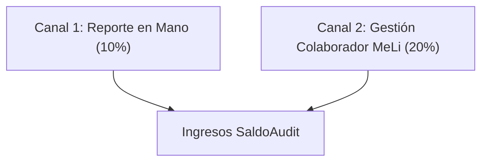

# Business Plan Maestro — SaldoAudit (Micro-SaaS B2B FinTech)

> **Empresa:** SaldoAudit  
> **Fundador:** Juan Manuel Oviedo  
> **Categoría:** Conciliación Forense B2B & Auditoría de Liquidaciones e-Commerce  
> **Mercado Objetivo:** Top Sellers de Mercado Libre Argentina (Facturación > $30M ARS/mes)

---

## 1. Resumen Ejecutivo & Tesis de Inversión

### El Problema (Fuga Invisible en Mercado Libre)
Mercado Libre procesa millones de operaciones mensuales bajo una logística altamente atomizada (Mercado Envíos Colecta, Flex y Full). En los últimos trimestres, **la plataforma eliminó las notificaciones automáticas y alertas proactivas al vendedor** sobre siniestros y devoluciones demoradas.

Esto genera una **fuga silenciosa permanente de capital** para los sellers:
1. **Siniestros de transporte impagos:** Paquetes rotos, extraviados o cancelados por demora del correo donde MeLi no acredita la indemnización a menos que el seller abra un reclamo formal antes de los 60 días corridos.
2. **La ventana crítica de 72 horas:** Devoluciones con productos usados, incompletos o cajas vacías donde el vendedor pierde el derecho a desconocer si no actúa dentro de los 3 días corridos post-entrega.
3. **Fletes cobrados indebidamente en Full:** Devoluciones donde el comprador abrió un reclamo injustificado y el flete inverso se le descuenta de la cuenta al vendedor en vez de ser absorbido por la protección oficial.

### La Solución (SaldoAudit)
Un motor forense que procesa localmente en el navegador el reporte oficial de ventas de Mercado Libre (.xlsx / .csv), cruza 67 columnas con la normativa reglamentaria y genera en 10 segundos la lista exacta de reclamos con sus montos y enlaces directos a soporte.

### Validación Comprobada
* **Caso Testigo:** Hudson Kitchenware (Hudson Cocina).
* **Volumen auditado:** 8.016 operaciones ($296.891.745 ARS brutos en 60 días).
* **Fuga detectada:** **$599.518,74 ARS** en 15 siniestros y reclamos recuperables.

---

## 2. Modelo de Negocio & Unit Economics

### Estructura de Ingresos (Monetización)

#### Nivel 1: Auditoría Express (10% sobre fondos detectados)
* **Ticket promedio:** $40.000 a $60.000 ARS por reporte.
* **Garantía:** Si MeLi rechaza +50% de reclamos en plazo, crédito a favor para el siguiente mes.
* **Margen bruto:** 98% (costo de cómputo client-side = $0).

#### Nivel 2: Gestión Integral VIP (20% a Éxito como Colaborador de MeLi)
* **Ticket promedio:** $80.000 a $120.000 ARS por mes por cuenta líder.
* SaldoAudit gestiona directamente los reclamos con soporte MeLi con rol restringido.
* Facturación mes vencido sobre fondos netos efectivamente acreditados.

### Proyección Financiera (Primeros 6 Meses)

| Mes | Sellers Activos | Volumen Auditado Mensual | Fuga Detectada Promedio | Facturación Mensual SaldoAudit (15% Prom) |
| :--- | :--- | :--- | :--- | :--- |
| **Mes 1** | 3 cuentas | $250M ARS | $1.200.000 ARS | **$180.000 ARS** |
| **Mes 2** | 6 cuentas | $500M ARS | $2.500.000 ARS | **$375.000 ARS** |
| **Mes 3** | 12 cuentas | $1.000M ARS | $5.000.000 ARS | **$750.000 ARS** |
| **Mes 6** | 25 cuentas | $2.200M ARS | $11.000.000 ARS | **$1.650.000 ARS** |

### Estructura de Costos Fijos
* Dominio oficial (.com / .com.ar): ~$15 USD / año.
* Base de datos Supabase: $0 (Plan Free / compartido en pool).
* Hosting estático (GitHub Pages / Vercel): $0.
* Margen Operativo Neto: **> 90%**.

---

## 3. Plan de Adquisición de Clientes (Go-To-Market)

1. **Estrategia Outbound Quirúrgica (LinkedIn + WhatsApp Directo):**
   * Identificación de MercadoLíderes Platinum en rubros de alto roce logístico:
     * *Autopartes y repuestos* (ticket alto, paquetes pesados rotos en viaje).
     * *Calzado e indumentaria* (15% a 25% tasa de devoluciones por talle).
     * *Bazar y cristalería* (alta tasa de roturas en correo).
     * *Electrónica de consumo* (siniestros de alto valor unitario).
2. **Propuesta Ganar-Ganar (El Caballo de Troya):**
   * Auditoría inicial sin cargo de los primeros 60 días para demostrar la fuga.
   * Entrega del informe con audio personalizado + planilla con links.
   * Conversión a plan de auditoría periódica o gestión completa.
