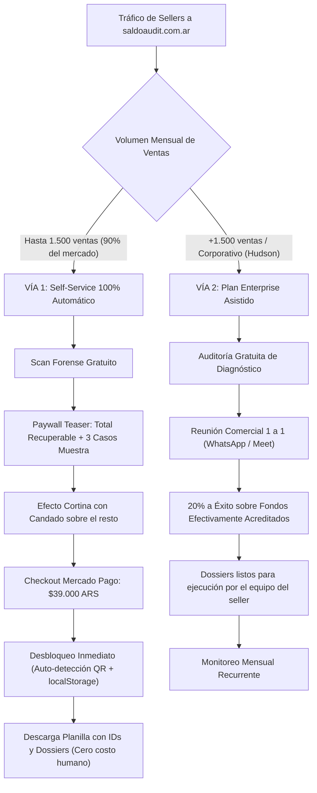

# Business Plan Maestro — SaldoAudit (Micro-SaaS B2B FinTech)

> **Empresa:** SaldoAudit (`saldoaudit.com.ar`)  
> **Fundador:** Juan Manuel Oviedo  
> **Categoría:** Conciliación Forense B2B & Recuperación de Fondos en Mercado Libre  
> **Modelo Benchmark:** Ecosistema global de recupero Amazon FBA (GETIDA / Carbon6) adaptado a Mercado Libre Hispanoamérica.

---

## 1. Resumen Ejecutivo & Tesis de Inversión

### El Problema (Fuga Invisible en Mercado Libre)
Mercado Libre procesa millones de operaciones mensuales bajo logística fragmentada (Mercado Envíos Colecta, Flex y Full). La plataforma eliminó las notificaciones automáticas y alertas proactivas al vendedor sobre siniestros de correo y devoluciones congeladas.

Esto genera una **fuga silenciosa permanente de capital** para los sellers:
1. **Siniestros de transporte impagos:** Paquetes rotos, extraviados o cancelados por demora del correo donde MeLi no acredita la indemnización a menos que el seller abra un reclamo formal antes de los 60 días corridos.
2. **La ventana crítica de 72 horas:** Devoluciones con productos usados, incompletos o cajas vacías donde el vendedor pierde el derecho a desconocer si no actúa dentro de los 3 días corridos post-entrega física.
3. **Fletes cobrados indebidamente en Full:** Devoluciones donde el comprador abrió un reclamo injustificado y el flete inverso se le descuenta de la cuenta al vendedor en vez de ser absorbido por la protección oficial.

### La Solución (SaldoAudit)
Un motor forense **Zero-Cloud Privacy** que procesa localmente en el navegador del usuario el reporte oficial de ventas de Mercado Libre (.xlsx / .csv), cruza 67 columnas normativas y genera en 1 segundo la lista exacta de reclamos con sus montos, argumentos legales y enlaces directos a soporte.

### Validación Comprobada
* **Caso Testigo:** Hudson Kitchenware (Hudson Cocina).
* **Volumen auditado:** 8.016 operaciones ($296.891.745 ARS brutos en 60 días).
* **Fuga detectada:** **$599.518,74 ARS** en 15 siniestros y reclamos recuperables.

---

## 2. Modelo de Negocio de 2 Vías (Dual Strategy)

Inspirado en el estándar de GETIDA para Amazon, SaldoAudit bifurca su modelo para eliminar la fricción de conversión y neutralizar la morosidad:

### VÍA 1: Self-Service Automático (Sellers Pequeños y Medianos)
* **Público:** Vendedores de hasta 1.500 ventas/mes.
* **Mecanismo:**
  1. Subida de archivo 100% gratuita y privada (*Zero-Cloud*).
  2. El sistema muestra la métrica de dinero recuperable total (ej. `+$184.500 ARS`) y un anticipo de 3 casos con ID enmascarado.
  3. **Efecto Cortina con Candado:** Las filas restantes quedan bloqueadas con Data Masking real (inaccesibles por consola o F12).
  4. **Desbloqueo:** Pago único de **$39.000 ARS** vía Mercado Pago Checkout Pro.
  5. **Auto-desbloqueo QR:** Si el seller paga desde su celular escaneando el QR, el navegador de la computadora detecta la acreditación por polling automático y desbloquea el informe sin que el usuario deba hacer nada.
  6. **Margen Bruto:** 100% limpio (cero horas hombre, cero costo de servidores).

### VÍA 2: Plan Enterprise / Corporativo (+1.500 ventas / Tipo Hudson)
* **Público:** Grandes marcas y cuentas corporativas.
* **Estructura:** **$0 Upfront + 20% Success Fee** sobre recupero efectivo.
* **Flujo Operativo Seguro:**
  * Para evitar las limitaciones técnicas de Mercado Libre (donde el rol de colaborador suele estar bloqueado para abrir tickets de soporte oficial de logística y envíos), SaldoAudit genera los dossiers legales listos y orienta al equipo interno del cliente para su ejecución directa.
  * Facturación quincenal o mensual del 20% contra el reporte de reintegros impactados en Mercado Pago.
  * Transición a **Monitoreo Mensual Continuo** (retainer o success fee periódico).

---

## 3. Infraestructura y Seguridad Técnica

1. **Frontend Público:** Single Page Application (Tailwind CSS, Lucide, SheetJS) alojada en Cloudflare Pages + GitHub Pages (`saldoaudit.com.ar`).
2. **Backend de Pagos & Webhooks:** Servicio Python en Google Cloud Platform (`api.saldoaudit.com.ar`) protegido con SSL oficial Let's Encrypt y Caddy.
3. **Idempotencia Antiduplicados:** Registro de `payment_id` procesados para evitar reenvío de notificaciones por email.
4. **CRM & Suite Interna:** Panel de gestión operativo (`saldoaudit.com.ar/app.html`) conectado a Supabase para seguimiento de cartera de 50+ grandes sellers.

---

## 4. Proyección Financiera (Primeros 6 Meses)

| Mes | Sellers Vía 1 (Self-Service $39k) | Cuentas Vía 2 (20% Éxito Prom $120k) | Facturación Mensual ARS | Margen Operativo |
| :--- | :--- | :--- | :--- | :--- |
| **Mes 1** | 5 ($195.000) | 2 ($240.000) | **$435.000 ARS** | > 92% |
| **Mes 2** | 12 ($468.000) | 4 ($480.000) | **$948.000 ARS** | > 94% |
| **Mes 3** | 25 ($975.000) | 8 ($960.000) | **$1.935.000 ARS** | > 95% |
| **Mes 6** | 60 ($2.340.000) | 18 ($2.160.000) | **$4.500.000 ARS** | > 95% |

---

## 5. Estrategia de Crecimiento & Go-To-Market

1. **Inbound Orgánico:** Tráfico al motor gratuito en `saldoaudit.com.ar` con conversión inmediata en el Paywall Teaser.
2. **Outbound Directo a Cuentas Grandes:** Cartera priorizada de 50 sellers líderes en `app.html` (Herramientas, Bazar, Calzado, Electrodomésticos) con abordaje vía WhatsApp institucional (+54 9 11 7237-6197) y LinkedIn.
3. **Alianzas Estratégicas:** Consultores de Mercado Libre que reciben una comisión recurrente por auditar a sus clientes con SaldoAudit.
