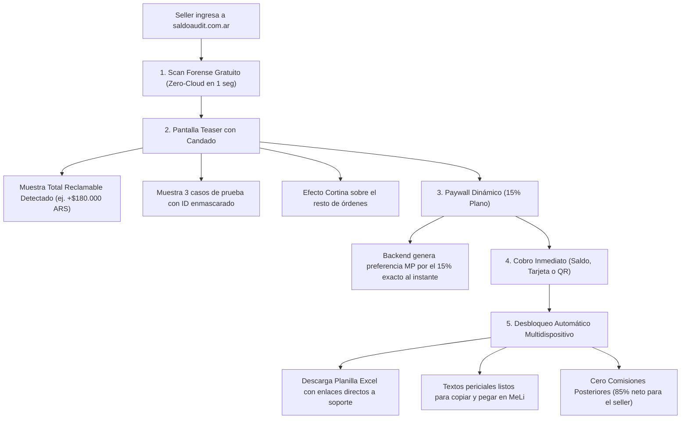

# Business Plan Maestro — SaldoAudit (Micro-SaaS B2B FinTech)

> **Empresa:** SaldoAudit (`saldoaudit.com.ar`)  
> **Fundador:** Juan Manuel Oviedo  
> **Categoría:** Conciliación Forense B2B & Recuperación de Fondos en Mercado Libre  
> **Modelo Benchmark:** Ecosistema global de recupero Amazon FBA (GETIDA / Carbon6) adaptado a Mercado Libre Hispanoamérica.

---

## 1. Resumen Ejecutivo & Tesis de Inversión

### El Problema (Fuga Invisible en Mercado Libre)
Mercado Libre procesa millones de operaciones mensuales bajo logística fragmentada (Mercado Envíos Colecta, Flex y Full). La plataforma eliminó las notificaciones automáticas y alertas proactivas al vendedor sobre siniestros de correo y devoluciones congeladas.

Esto genera una **fuga silenciosa permanente de capital** para los sellers:
1. **Siniestros de transporte impagos:** Paquetes rotos, extraviados o cancelados por demora del correo donde MeLi no acredita la indemnización a menos que el seller abra un reclamo formal antes de los 60 días corridos.
2. **La ventana crítica de 72 horas:** Devoluciones con productos usados, incompletos o cajas vacías donde el vendedor pierde el derecho a desconocer si no actúa dentro de los 3 días corridos post-entrega física.
3. **Fletes cobrados indebidamente en Full:** Devoluciones donde el comprador abrió un reclamo injustificado y el flete inverso se le descuenta de la cuenta al vendedor en vez de ser absorbido por la protección oficial.

### La Solución (SaldoAudit)
Un motor forense **Zero-Cloud Privacy** que procesa localmente en el navegador del usuario el reporte oficial de ventas de Mercado Libre (.xlsx / .csv), cruza 67 columnas normativas y genera en 1 segundo la lista exacta de reclamos con sus montos, argumentos legales y enlaces directos a soporte.

### Validación Comprobada
* **Caso Testigo:** Hudson Kitchenware (Hudson Cocina).
* **Volumen auditado:** 8.016 operaciones ($296.891.745 ARS brutos en 60 días).
* **Fuga detectada:** **$599.518,74 ARS** en 15 siniestros y reclamos recuperables.

---

## 2. Modelo de Negocio: Micro-SaaS 100% Automatizado (Zero-Touch)

SaldoAudit opera como un software de autoservicio puro con cobro previo a la entrega del reporte, eliminando el riesgo de morosidad y cualquier costo de intermediación humana:

### Características del Modelo

1. **Scan Forense Gratuito:** El seller sube su reporte de ventas a la web. El algoritmo procesa los datos localmente en el navegador en 1 segundo con privacidad *Zero-Cloud*.
2. **Pantalla Teaser:** Muestra el monto total en verde recuperable (ej. `$180.000 ARS`) con el detalle de órdenes y enlaces bloqueados por candado.
3. **Paywall de Desbloqueo Dinámico:** Se calcula automáticamente el **15% plano sobre el total detectado**. El backend genera la preferencia de Mercado Pago por ese monto exacto al instante.
4. **Cobro Inmediato:** El cliente paga con saldo en cuenta, QR o tarjeta de crédito.
5. **Descarga Instantánea:** La web se desbloquea sola (con soporte de detección de pago QR en celular) y habilita la descarga de la planilla Excel con IDs de venta, textos de reclamo y links directos a soporte de MeLi.
6. **Comisiones Futuras:** 0% (el cliente se queda con el 85% restante acreditado directo en su Mercado Pago).

---

## 3. Garantía Técnica

* **Reintegro directo del 15%** correspondiente a cualquier caso de siniestro oficial que Mercado Libre rechace indemnizar, contra captura del ticket de soporte.

---

## 4. Métricas y Unit Economics

* **Intervención humana:** 0 minutos por transacción.
* **Costo marginal por usuario:** $0 ARS (cómputo cliente-side).
* **Riesgo de morosidad:** 0% (cobro previo a la entrega del reporte).
* **Margen operativo bruto:** > 95%.

---

## 5. Proyección Financiera (Primeros 6 Meses)

| Mes | Sellers que Desbloquean | Recupero Promedio Detectado | Ticket Promedio SaldoAudit (15%) | Facturación Mensual ARS | Margen Operativo |
| :--- | :--- | :--- | :--- | :--- | :--- |
| **Mes 1** | 10 cuentas | $180.000 ARS | $27.000 ARS | **$270.000 ARS** | > 95% |
| **Mes 2** | 25 cuentas | $220.000 ARS | $33.000 ARS | **$825.000 ARS** | > 95% |
| **Mes 3** | 50 cuentas | $250.000 ARS | $37.500 ARS | **$1.875.000 ARS** | > 95% |
| **Mes 6** | 120 cuentas | $300.000 ARS | $45.000 ARS | **$5.400.000 ARS** | > 95% |

---

## 5. Estrategia de Crecimiento & Go-To-Market

1. **Inbound Orgánico:** Tráfico al motor gratuito en `saldoaudit.com.ar` con conversión inmediata en el Paywall Teaser.
2. **Outbound Directo a Cuentas Grandes:** Cartera priorizada de 50 sellers líderes en `app.html` (Herramientas, Bazar, Calzado, Electrodomésticos) con abordaje vía WhatsApp institucional (+54 9 11 7237-6197) y LinkedIn.
3. **Alianzas Estratégicas:** Consultores de Mercado Libre que reciben una comisión recurrente por auditar a sus clientes con SaldoAudit.
